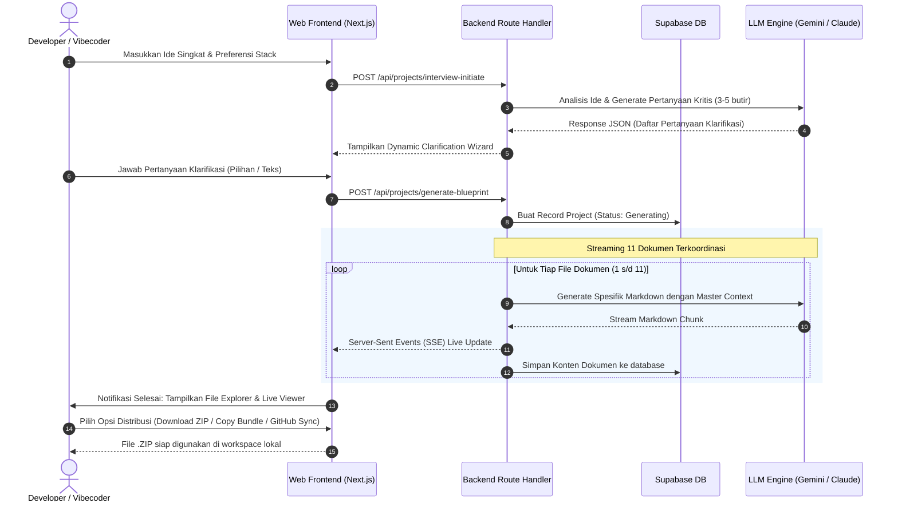

# Product Requirements Document (PRD): AppPlanner AI (PlanCraft)

- **Product Name:** AppPlanner AI (PlanCraft)
- **Document Version:** v1.0.0
- **Status:** Approved / Pre-Development
- **Target Audience:** Developers, Vibecoders, Technical Product Managers, AI Engineers
- **Backend & Auth Platform:** Supabase (PostgreSQL, Auth, Storage)
- **Frontend & Fullstack Stack:** Next.js 15 (App Router), TypeScript, Tailwind CSS, Shadcn UI

---

## 1. Executive Summary & Problem Statement

### 1.1. Problem Statement
Dengan meledaknya era *AI-assisted development* dan *vibecoding* (mengembangkan aplikasi menggunakan AI tools seperti Cursor, Antigravity, Claude Dev, Windsurf, Copilot Workspace), banyak pengembang menghadapi masalah kritis:
1. **Context Drift & AI Hallucination:** Saat meminta AI membuat aplikasi kompleks, AI sering mengubah nama kolom database, merancang endpoint yang tidak konsisten, atau melupakan aturan autentikasi di tengah jalan karena tidak ada satu sumber kebenaran (*single source of truth*).
2. **Prompt Fatigue & Specification Gap:** Menulis dokumen perencanaan seperti PRD, arsitektur, ERD, dan spesifikasi API dari nol membutuhkan waktu berhari-hari. Banyak vibecoder langsung coding tanpa perencanaan, menghasilkan hutang teknis (*technical debt*) yang parah setelah 2-3 hari.
3. **Fragmentasi Dokumen:** Jika meminta ChatGPT/Claude menghasilkan dokumen satu per satu, formatnya sering tidak sinkron dan sulit diintegrasikan ke dalam folder repositori kerja.

### 1.2. The Solution
**AppPlanner AI** hadir sebagai *Automated Pre-Development Engine* terintegrasi. Pengguna hanya perlu memberikan ide mentah; AI kemudian memandu lewat wawancara singkat interaktif (*Hybrid Interview*), lalu menghasilkan **11 paket dokumen blueprint teknis yang saling terhubung dan siap pakai** (`map.md`, `PRD.md`, `design_sistem.md`, `wireframes.md`, `security.md`, `architecture.md`, `database_schema.md`, `api_spec.md`, `qa.md`, `deployment.md`, `CONTRIBUTING.md`). Dokumen dapat dipreview, disalin, atau diekspor sebagai bundel ZIP maupun direktori konteks AI coding.

---

## 2. Product Objectives & Success Metrics (OKRs)

### 2.1. Objectives
- Memangkas waktu perencanaan pre-development proyek software dari rata-rata **16 jam** menjadi kurang dari **5 menit**.
- Menjadi standar de-facto generator konteks prompt (*context package*) bagi para pengembang di ekosistem AI coding.
- Memberikan konsistensi arsitektur dan penamaan skema 100% sinkron antar seluruh dokumen yang dihasilkan.

### 2.2. Key Metrics
- **Time-to-Blueprint:** Rata-rata waktu dari input ide awal hingga 11 file selesai digenerate < 90 detik.
- **Blueprint Completion Rate:** > 85% pengguna yang memulai proses wawancara menyelesaikan ekspor blueprint.
- **Export Utility Rate:** > 60% pengguna mendownload bundle ZIP atau menyalin blueprint ke workspace mereka.
- **AI Consistency Score:** 0 inkonsistensi skema database antara `database_schema.md` dan `api_spec.md`.

---

## 3. User Personas

| Persona | Profil & Karakteristik | Pain Point Utama | Kebutuhan Solusi |
|---|---|---|---|
| **Vibecoder / Indie Hacker (Alex)** | Coding cepat menggunakan tools AI, sering meluncurkan MVP dalam hitungan hari. Tidak suka menulis dokumentasi formal. | Proyek sering rusak atau macet setelah fitur ketiga karena AI bingung dengan skema database yang berubah-ubah. | Satu set dokumen arsitektur instan yang bisa langsung ditempelkan ke aturan AI (`.cursorrules` / `.gemini`). |
| **Fullstack Freelancer (Budi)** | Mengerjakan pesanan klien (web/mobile). Butuh proposal teknis dan arsitektur formal sebelum coding dimulai. | Membuat PRD dan spesifikasi API menyita 40% waktu proposal awal sebelum dibayar. | Template pre-development profesional dan terstruktur rapi untuk ditunjukkan ke klien dan tim dev. |
| **System Admin (Citra)** | Pengelola platform internal AppPlanner AI. Bertanggung jawab atas efisiensi biaya API dan kualitas output. | Biaya token LLM melonjak tanpa kendali dan template prompt lama tidak fleksibel. | Dashboard monitoring token, konfigurasi model AI terpusat, dan manajemen peran (*RBAC*). |

---

## 4. User Journey & Workflow (Hybrid UX Flow)

---

## 5. Scope & Functional Requirements

### 5.1. Modul Autentikasi & RBAC
- **FR-AUTH-01:** Pengguna dapat mendaftar dan masuk menggunakan Email & Password dengan konfirmasi email otomatis Supabase.
- **FR-AUTH-02:** Pengguna dapat masuk menggunakan single sign-on (SSO) OAuth: GitHub dan Google.
- **FR-AUTH-03:** Sistem menerapkan 2 level Role: `admin` dan `user`.
- **FR-AUTH-04:** Proteksi route: `/admin/*` hanya dapat diakses oleh role `admin`, sedangkan `/app/*` untuk user terotentikasi.

### 5.2. Modul Discovery & Hybrid Interviewer
- **FR-DISC-01:** Pengguna dapat mengisi nama proyek, deskripsi ide aplikasi singkat (minimal 10 karakter), serta pilihan tech stack (opsional/rekomendasi otomatis).
- **FR-DISC-02:** Sistem mengirim brief ke AI untuk mendeteksi ambiguitas teknis dan mengembalikan 3 hingga 5 pertanyaan klarifikasi spesifik (misal: "Apakah membutuhkan multi-tenancy?", "Siapa pihak ketiga sistem pembayaran?").
- **FR-DISC-03:** User dapat menjawab melalui antarmuka kartu pertanyaan interaktif (multi-choice rekomendasi + custom input).
- **FR-DISC-04:** User dapat mereview ringkasan spesifikasi final sebelum memulai proses eksekusi kompilasi.

### 5.3. Modul Generator 11 Dokumen Terstruktur
- **FR-GEN-01:** Sistem menghasilkan secara terpadu 11 file pre-development standar:
  1. `map.md`: Roadmap, sitemap, dan dekomposisi hierarki fitur.
  2. `PRD.md`: Dokumen persyaratan produk, user persona, acceptance criteria.
  3. `design_sistem.md`: Panduan UI/UX, token warna Tailwind, tipografi, komponen.
  4. `wireframes.md`: Wireframe visual berbasis teks/ASCII responsif (desktop & mobile), struktur tata letak antarmuka, dan alur interaksi per role.
  5. `security.md`: Kebijakan keamanan, otentikasi, RLS Supabase, sanitasi data.
  6. `architecture.md`: Diagram sistem, data flow, struktur folder repositori.
  7. `database_schema.md`: DDL PostgreSQL, relasi tabel, indexing, ERD Mermaid.
  8. `api_spec.md`: Kontrak endpoint REST/RPC, request/response schema.
  9. `qa.md`: Skenario testing E2E/Unit, edge cases, acceptance checklist.
  10. `deployment.md`: CI/CD GitHub Actions, environment variables, hosting.
  11. `CONTRIBUTING.md`: Panduan setup lokal, branching model, konvensi commit.
- **FR-GEN-02:** Sistem menggunakan teknik *Master Context Injection* agar entitas data dan istilah teknis di seluruh 11 file 100% konsisten.
- **FR-GEN-03:** Sistem menampilkan progress bar real-time dan log status pembuatan file secara live via Server-Sent Events (SSE).

### 5.4. Modul Workspace & Distribusi File (Opsi B)
- **FR-WORK-01:** Tampilan antarmuka *split-screen*: Panel kiri berupa File Explorer pohon direktori; panel kanan berupa Markdown Viewer & Editor interaktif.
- **FR-WORK-02:** Viewer mendukung *syntax highlighting* untuk blok kode (`sql`, `typescript`, `json`, `bash`) dan visualisasi diagram `mermaid`.
- **FR-WORK-03:** Tombol "Copy Content" satu klik untuk setiap dokumen aktif.
- **FR-WORK-04:** Fitur "Download ZIP Archive" yang mengompresi ke-11 file ke dalam format `.zip` langsung dari browser dengan struktur direktori yang bersih.
- **FR-WORK-05:** Fitur "Copy as AI Context Bundle" yang menggabungkan intisari ke-11 dokumen ke dalam 1 file prompt master untuk di-paste langsung ke LLM context window.

### 5.5. Modul Admin Console
- **FR-ADM-01:** Admin dapat melihat daftar seluruh user, statistik proyek yang dibuat, dan mengubah role user.
- **FR-ADM-02:** Admin dapat mengelola *System Prompt Templates* yang digunakan engine untuk masing-masing tipe dokumen.
- **FR-ADM-03:** Admin dapat melihat metrik konsumsi token LLM (Prompt Tokens, Completion Tokens, Total Cost) per periode waktu.

---

## 6. Non-Functional Requirements (NFR)

| Kategori | Parameter | Target Spesifikasi |
|---|---|---|
| **Performance** | Time-to-First-Token (TTFT) | < 2.5 detik saat inisiasi streaming dokumen. |
| **Performance** | Full 11-File Generation | Selesai dalam < 120 detik (menggunakan model berkecepatan tinggi seperti Gemini 2.0 Flash / Claude 3.5 Haiku/Sonnet). |
| **Reliability** | AI Generation Resilience | Mekanisme *retry with backoff* otomatis hingga 3x jika koneksi LLM mengalami rate limit atau timeout. |
| **Security** | Data Isolation | Supabase Row Level Security (RLS) menjamin user hanya dapat membaca dan mengedit proyek miliknya sendiri. |
| **Security** | Sensitive Data | API Key pihak ketiga (misal: user BYOK) wajib dienkripsi di level basis data menggunakan AES-256-GCM. |
| **Usability** | Device Compatibility | Responsif di desktop (primary viewport >= 1024px untuk dual-pane) dan tablet/mobile (single pane collapsible). |
| **Accessibility** | WCAG 2.1 | Memenuhi standar level AA untuk rasio kontras warna dan navigasi keyboard. |

---

## 7. Assumptions, Dependencies & Risk Mitigation

1. **Dependensi LLM Rate Limiting:**
   - *Risiko:* Provider AI (Google/Anthropic/OpenAI) mengembalikan error 429 Too Many Requests saat beberapa file digenerate paralel.
   - *Mitigasi:* Menggunakan arsitektur *generation queue* atau sekuensial ter-batch (generate file kritis terlebih dahulu, misal `PRD.md` & `database_schema.md`, lalu turunan lainnya).
2. **Konteks Token Length:**
   - *Risiko:* Proyek berukuran sangat besar dapat melampaui context window atau menyebabkan penurunan kualitas output.
   - *Mitigasi:* Menyediakan *System Summary Context* berukuran padat (maksimal 1.500 token) yang diinjeksi ke masing-masing sub-prompt dokumen.
3. **Penyimpanan Dokumen di Database:**
   - *Risiko:* Dokumen teks yang panjang memenuhi batas kuota penyimpanan database.
   - *Mitigasi:* Dokumen disimpan dalam kolom `text` terkompresi atau Supabase Storage Bucket bila ukuran melebihi 100 KB.
