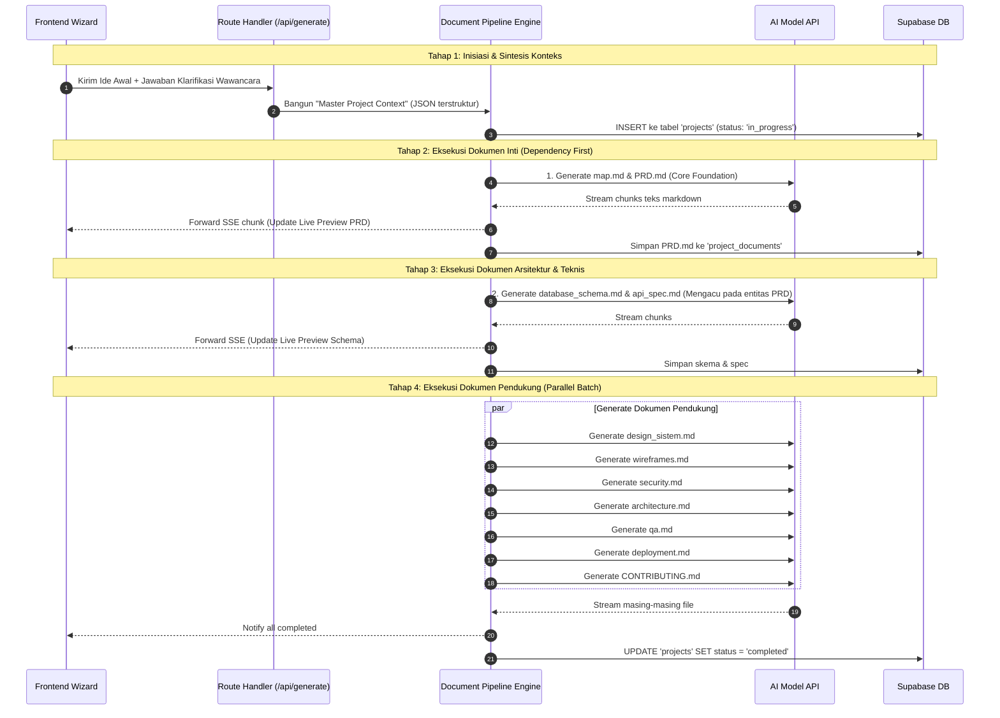

# Technical Architecture & Component Breakdown: AppPlanner AI

Dokumen ini mendokumentasikan arsitektur teknis menyeluruh, diagram sistem, aliran data (*data flow*), hierarki komponen perangkat lunak, serta struktur repositori kode untuk **AppPlanner AI (PlanCraft)**.

---

## 1. High-Level System Architecture

Arsitektur sistem dibangun dengan pola modern **Serverless Jamstack / Edge-first** yang memisahkan lapisan presentasi, orkestrasi backend, layanan persistensi data, dan model kecerdasan buatan (*LLM Engine*).

```mermaid
flowchart TD
    subgraph ClientLayer ["Client Layer (Browser)"]
        UI["Next.js React 19 Client UI"]
        Viewer["Dual-Pane Markdown & Mermaid Viewer"]
        ZipGen["Client-Side ZIP Generator (JSZip)"]
    end

    subgraph EdgeBackend ["Application & API Layer (Next.js App Router on Vercel)"]
        Middleware["Edge Middleware (Auth & Role Guard)"]
        RouteHandlers["Server Route Handlers (/api/*)"]
        Orchestrator["LLM Multi-Document Orchestrator (Vercel AI SDK)"]
        ContextSynthesizer["Context Synthesizer & Validator (Zod)"]
    end

    subgraph DataPlatform ["Data Platform (Supabase)"]
        SupaAuth["Supabase Auth (JWT & OAuth)"]
        Postgres["PostgreSQL DB (with RLS)"]
        SupaStorage["Supabase Storage (Export Bundles & Backups)"]
        Realtime["Supabase Realtime (Live Sync status)"]
    end

    subgraph LLMProviders ["AI Model Providers (Managed APIs)"]
        Gemini["Google Gemini 2.0 Flash / 1.5 Pro (High Throughput & Speed)"]
        Claude["Anthropic Claude 3.5 Sonnet (High Precision Architecture)"]
        OpenAI["OpenAI GPT-4o (Fallback)"]
    end

    %% Connections
    UI <-->|HTTPS / SSE Streaming| RouteHandlers
    UI -->|Static Asset Cache| Middleware
    Middleware --> RouteHandlers
    RouteHandlers --> SupaAuth
    RouteHandlers --> Postgres
    RouteHandlers --> SupaStorage
    RouteHandlers <--> Orchestrator
    Orchestrator <--> ContextSynthesizer
    Orchestrator <-->|Unified AI SDK Stream| Gemini
    Orchestrator -.->|Fallback / Switch| Claude
    Postgres <--> Realtime
    Realtime -.-> UI
    ZipGen <-- UI
```

---

## 2. Technology Stack Selection & Rationale

| Layer / Kebutuhan | Teknologi Pilihan | Alasan Pemilihan & Keunggulan |
|---|---|---|
| **Framework Fullstack** | **Next.js 15 (App Router, React 19)** | Server Components untuk kecepatan render awal, API Routes terpadu, kompatibilitas Server-Sent Events (SSE) yang matang. |
| **Bahasa Pemrograman** | **TypeScript (Strict Mode)** | Tipe data kuat dari skema database hingga kontrak respons API, meminimalkan bug runtime. |
| **Styling & UI Kit** | **Tailwind CSS v4 + Shadcn UI (Radix)** | Komponen headless yang sepenuhnya dapat dikustomisasi, zero-runtime CSS overhead, tema gelap konsisten. |
| **State Management** | **Zustand + TanStack React Query v5** | Zustand untuk UI state lokal (tab aktif, input draft), React Query untuk caching data proyek server dan revalidasi otomatis. |
| **Backend & Database** | **Supabase (PostgreSQL 15+)** | Fitur all-in-one: Auth, Row Level Security (RLS) tangguh, triggers otomatis, JSONB queries, dan Supabase Storage. |
| **AI Integration Library** | **Vercel AI SDK (`ai`)** | Abstraksi multi-provider terbaik dengan dukungan streaming terstandarisasi (`streamText`), tool calling, dan validasi Zod. |
| **Primary LLM** | **Google Gemini 2.0 Flash / 1.5 Pro** | Context window raksasa (1M+ tokens), latency rendah, biaya per token sangat efisien untuk output dokumen masif. |
| **File Compression** | **JSZip + FileSaver.js** | Kompresi 11 file markdown langsung di memori browser pengguna tanpa membebani bandwidth kompresi server. |
| **Diagram Rendering** | **Mermaid.js** | Standar render diagram di ekosistem markdown developer (ERD, sequence flow, flowchart). |

---

## 3. Data Flow & Generation Pipeline

Proses dari ide mentah hingga 11 file dokumen terbagi menjadi 3 pipeline sekuensial yang terkoordinasi:



---

## 4. Component Hierarchy (Frontend Layout)

Struktur komponen frontend dipecah secara modular untuk memastikan *reusability* dan kemudahan *testing*:

```
<AppLayout>
  |-- <AppNavbar> (Brand, Breadcrumbs, UserDropdown, RoleBadge)
  |-- <DashboardView> (Project Card Grid, New Project Button, Analytics Summary)
  |-- <WizardModal> (Hybrid Interview Engine)
  |     |-- <StepIndicator> (Progress: Idea -> Clarify -> Generate)
  |     |-- <IdeaInputForm> (Textarea, Category Tags, Stack Checkboxes)
  |     |-- <ClarificationCards> (AI Dynamic Q&A Interactive Cards)
  |     \-- <ConfirmationSummary> (Final Master Context Approval)
  |-- <WorkspaceWorkspaceView> (Dual-Pane Split Screen)
        |-- <WorkspaceHeader> (Project Title, Status Badge, Export ZIP CTA)
        |-- <ResizableSplitter>
              |-- <FileTreeSidebar>
              |     |-- <SearchFileFilter>
              |     \-- <FileItemList>
              |           |-- <FileItem> (Status Icon, Filename, Action Menu)
              \-- <DocumentViewerContainer>
                    |-- <ViewerHeader> (Active Filename, Word Count, Copy Button, Raw/Preview Toggle)
                    |-- <MarkdownRenderer>
                    |     |-- <SyntaxHighlighter> (Prism code blocks)
                    |     \-- <MermaidRenderer> (Interactive zoom/pan canvas)
                    \-- <FloatingActionsBar> (Download Current, Download All ZIP)
```

---

## 5. Repository Directory Structure

Struktur direktori mengikuti standar **Next.js 15 App Router** dengan pemisahan domain yang rapi:

```
app-planner-code/
├── .agents/                    # Konfigurasi skill dan aturan AI subagents
├── public/                     # Aset statis publik (logos, favicon, demo images)
├── src/
│   ├── app/                    # Next.js App Router Routes
│   │   ├── (auth)/             # Route group untuk alur otentikasi
│   │   │   ├── login/page.tsx
│   │   │   └── register/page.tsx
│   │   ├── (dashboard)/        # Route group terproteksi untuk User
│   │   │   ├── app/
│   │   │   │   ├── page.tsx               # Project list dashboard
│   │   │   │   ├── projects/new/page.tsx  # Wizard generator
│   │   │   │   ├── projects/[id]/page.tsx # Dual-pane workspace viewer
│   │   │   │   └── settings/page.tsx      # User settings & API Keys
│   │   ├── (admin)/            # Route group terproteksi untuk Role Admin
│   │   │   └── admin/
│   │   │       ├── dashboard/page.tsx     # Metrics & token usage
│   │   │       ├── users/page.tsx         # User & role management
│   │   │       └── templates/page.tsx     # System prompt configuration
│   │   ├── api/                # Backend API Route Handlers
│   │   │   ├── auth/callback/route.ts
│   │   │   ├── interview/route.ts         # Hybrid Q&A clarification endpoint
│   │   │   ├── generate/route.ts          # Streaming SSE 11-file generation
│   │   │   └── projects/[id]/export/route.ts # Server-side export bundle
│   │   ├── layout.tsx          # Root layout (Fonts, ThemeProvider, Toaster)
│   │   └── page.tsx            # Marketing Landing Page
│   ├── components/             # Reusable UI & Feature Components
│   │   ├── ui/                 # Shadcn UI primitives (button, dialog, card, tabs)
│   │   ├── shared/             # Header, Footer, Sidebar, ThemeToggle
│   │   ├── wizard/             # Komponen formulir wawancara hybrid
│   │   ├── workspace/          # File tree, Markdown viewer, Mermaid canvas
│   │   └── admin/              # Komponen tabel analytics dan audit logs
│   ├── lib/                    # Utilitas, clients, dan konfigurasi inti
│   │   ├── supabase/           # Client & Server Supabase connectors
│   │   │   ├── client.ts       # Browser client
│   │   │   ├── server.ts       # Server-side cookies client
│   │   │   └── middleware.ts   # Edge session validator
│   │   ├── ai/                 # LLM provider configs & prompts
│   │   │   ├── providers.ts    # Model setup (Gemini, Claude, OpenAI)
│   │   │   ├── orchestrator.ts # Pipeline generator 11 dokumen
│   │   │   └── prompts/        # System prompts untuk masing-masing file
│   │   ├── utils.ts            # Helper function (cn, formatBytes, timeAgo)
│   │   └── export-zip.ts       # Utility pembuatan ZIP di browser (JSZip)
│   ├── types/                  # TypeScript interface & database types
│   │   ├── database.types.ts   # Auto-generated Supabase types
│   │   ├── project.ts          # Tipe data Project, FileItem, Status
│   │   └── interview.ts        # Tipe data Q&A Clarification Wizard
│   └── hooks/                  # Custom React Hooks
│       ├── use-project-stream.ts # Hook untuk mengonsumsi SSE streaming
│       └── use-user-role.ts    # Hook untuk memeriksa hak akses role
├── middleware.ts               # Edge Middleware pengaman route
├── tailwind.config.ts          # Konfigurasi Tailwind & Theme tokens
├── tsconfig.json               # Konfigurasi TypeScript compiler
└── package.json                # Dependensi proyek
```
