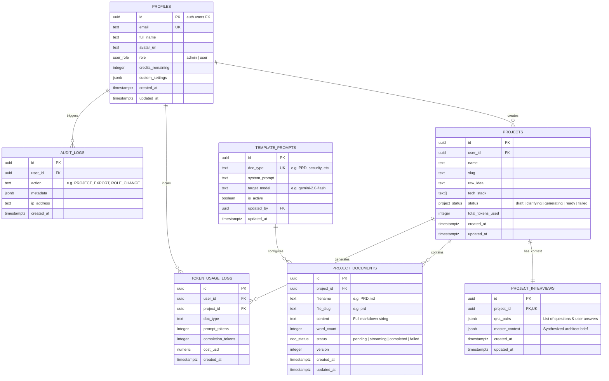

# Database Schema & ERD Specification: AppPlanner AI

Dokumen ini memuat skema basis data relasional PostgreSQL lengkap yang dihosting di atas **Supabase**, mencakup definisi tabel DDL (*Data Definition Language*), tipe data enumerasi, relasi kunci asing (*Foreign Keys*), *indexes*, *triggers* otomatis, dan diagram relasi entitas (*ERD*).

---

## 1. Entity Relationship Diagram (ERD)



---

## 2. PostgreSQL Custom Enums

```sql
-- 1. Enum untuk Peran Pengguna
CREATE TYPE public.user_role AS ENUM ('user', 'admin');

-- 2. Enum untuk Status Lifecycle Proyek
CREATE TYPE public.project_status AS ENUM (
  'draft',
  'clarifying',
  'generating',
  'ready',
  'failed'
);

-- 3. Enum untuk Status Dokumen Individual
CREATE TYPE public.doc_status AS ENUM (
  'pending',
  'streaming',
  'completed',
  'failed'
);
```

---

## 3. Data Definition Language (DDL) Script

```sql
-- Mengaktifkan ekstensi UUID
CREATE EXTENSION IF NOT EXISTS "uuid-ossp";

-- ============================================================================
-- 1. TABEL: PROFILES (Ekstensi dari Supabase auth.users)
-- ============================================================================
CREATE TABLE public.profiles (
    id UUID PRIMARY KEY REFERENCES auth.users(id) ON DELETE CASCADE,
    email TEXT NOT NULL UNIQUE,
    full_name TEXT,
    avatar_url TEXT,
    role public.user_role NOT NULL DEFAULT 'user',
    credits_remaining INTEGER NOT NULL DEFAULT 10,
    custom_settings JSONB DEFAULT '{}'::jsonb,
    created_at TIMESTAMPTZ NOT NULL DEFAULT timezone('utc'::text, now()),
    updated_at TIMESTAMPTZ NOT NULL DEFAULT timezone('utc'::text, now())
);

-- ============================================================================
-- 2. TABEL: PROJECTS (Blueprint Project Master)
-- ============================================================================
CREATE TABLE public.projects (
    id UUID PRIMARY KEY DEFAULT uuid_generate_v4(),
    user_id UUID NOT NULL REFERENCES public.profiles(id) ON DELETE CASCADE,
    name TEXT NOT NULL,
    slug TEXT NOT NULL,
    raw_idea TEXT NOT NULL,
    tech_stack TEXT[] DEFAULT ARRAY[]::TEXT[],
    status public.project_status NOT NULL DEFAULT 'draft',
    total_tokens_used INTEGER NOT NULL DEFAULT 0,
    created_at TIMESTAMPTZ NOT NULL DEFAULT timezone('utc'::text, now()),
    updated_at TIMESTAMPTZ NOT NULL DEFAULT timezone('utc'::text, now())
);

-- ============================================================================
-- 3. TABEL: PROJECT_INTERVIEWS (Konteks Hasil Wawancara Klarifikasi)
-- ============================================================================
CREATE TABLE public.project_interviews (
    id UUID PRIMARY KEY DEFAULT uuid_generate_v4(),
    project_id UUID NOT NULL UNIQUE REFERENCES public.projects(id) ON DELETE CASCADE,
    qna_pairs JSONB NOT NULL DEFAULT '[]'::jsonb,
    master_context JSONB NOT NULL DEFAULT '{}'::jsonb,
    created_at TIMESTAMPTZ NOT NULL DEFAULT timezone('utc'::text, now()),
    updated_at TIMESTAMPTZ NOT NULL DEFAULT timezone('utc'::text, now())
);

-- ============================================================================
-- 4. TABEL: PROJECT_DOCUMENTS (11 File Markdown per Project)
-- ============================================================================
CREATE TABLE public.project_documents (
    id UUID PRIMARY KEY DEFAULT uuid_generate_v4(),
    project_id UUID NOT NULL REFERENCES public.projects(id) ON DELETE CASCADE,
    filename TEXT NOT NULL,
    file_slug TEXT NOT NULL,
    content TEXT NOT NULL DEFAULT '',
    word_count INTEGER NOT NULL DEFAULT 0,
    status public.doc_status NOT NULL DEFAULT 'pending',
    version INTEGER NOT NULL DEFAULT 1,
    created_at TIMESTAMPTZ NOT NULL DEFAULT timezone('utc'::text, now()),
    updated_at TIMESTAMPTZ NOT NULL DEFAULT timezone('utc'::text, now()),
    CONSTRAINT unique_project_filename UNIQUE (project_id, filename)
);

-- ============================================================================
-- 5. TABEL: TEMPLATE_PROMPTS (Konfigurasi System Prompt Terpusat)
-- ============================================================================
CREATE TABLE public.template_prompts (
    id UUID PRIMARY KEY DEFAULT uuid_generate_v4(),
    doc_type TEXT NOT NULL UNIQUE,
    system_prompt TEXT NOT NULL,
    target_model TEXT NOT NULL DEFAULT 'gemini-2.0-flash',
    is_active BOOLEAN NOT NULL DEFAULT true,
    updated_by UUID REFERENCES public.profiles(id),
    updated_at TIMESTAMPTZ NOT NULL DEFAULT timezone('utc'::text, now())
);

-- ============================================================================
-- 6. TABEL: TOKEN_USAGE_LOGS (Pelacak Biaya & Audit Kuota LLM)
-- ============================================================================
CREATE TABLE public.token_usage_logs (
    id UUID PRIMARY KEY DEFAULT uuid_generate_v4(),
    user_id UUID NOT NULL REFERENCES public.profiles(id) ON DELETE CASCADE,
    project_id UUID REFERENCES public.projects(id) ON DELETE SET NULL,
    doc_type TEXT NOT NULL,
    prompt_tokens INTEGER NOT NULL DEFAULT 0,
    completion_tokens INTEGER NOT NULL DEFAULT 0,
    cost_usd NUMERIC(10, 6) NOT NULL DEFAULT 0.000000,
    created_at TIMESTAMPTZ NOT NULL DEFAULT timezone('utc'::text, now())
);

-- ============================================================================
-- 7. TABEL: AUDIT_LOGS (Keamanan & Aktivitas Sensitif)
-- ============================================================================
CREATE TABLE public.audit_logs (
    id UUID PRIMARY KEY DEFAULT uuid_generate_v4(),
    user_id UUID REFERENCES public.profiles(id) ON DELETE SET NULL,
    action TEXT NOT NULL,
    metadata JSONB DEFAULT '{}'::jsonb,
    ip_address TEXT,
    created_at TIMESTAMPTZ NOT NULL DEFAULT timezone('utc'::text, now())
);
```

---

## 4. Performance Indexes

```sql
-- Index untuk query proyek berdasarkan user_id (paling sering dipanggil di dashboard)
CREATE INDEX idx_projects_user_id ON public.projects(user_id);

-- Index untuk filter status proyek
CREATE INDEX idx_projects_status ON public.projects(status);

-- Composite Index untuk dokumen berdasarkan project_id dan file_slug
CREATE INDEX idx_project_docs_lookup ON public.project_documents(project_id, file_slug);

-- Index untuk log penggunaan token per user dan waktu
CREATE INDEX idx_token_usage_user_time ON public.token_usage_logs(user_id, created_at DESC);

-- Index untuk log audit
CREATE INDEX idx_audit_logs_action ON public.audit_logs(action, created_at DESC);
```

---

## 5. Automated Database Triggers

### 5.1. Auto-create Profile Saat User Mendaftar di Supabase Auth
```sql
CREATE OR REPLACE FUNCTION public.handle_new_user()
RETURNS TRIGGER AS $$
BEGIN
  INSERT INTO public.profiles (id, email, full_name, avatar_url, role, credits_remaining)
  VALUES (
    NEW.id,
    NEW.email,
    COALESCE(NEW.raw_user_meta_data->>'full_name', NEW.email),
    NEW.raw_user_meta_data->>'avatar_url',
    'user',
    10 -- Default 10 gratis token blueprint untuk user baru
  );
  RETURN NEW;
END;
$$ LANGUAGE plpgsql SECURITY DEFINER;

CREATE TRIGGER on_auth_user_created
  AFTER INSERT ON auth.users
  FOR EACH ROW EXECUTE FUNCTION public.handle_new_user();
```

### 5.2. Auto-update Kolom `updated_at`
```sql
CREATE OR REPLACE FUNCTION public.trigger_set_timestamp()
RETURNS TRIGGER AS $$
BEGIN
  NEW.updated_at = timezone('utc'::text, now());
  RETURN NEW;
END;
$$ LANGUAGE plpgsql;

CREATE TRIGGER set_timestamp_profiles
  BEFORE UPDATE ON public.profiles
  FOR EACH ROW EXECUTE FUNCTION public.trigger_set_timestamp();

CREATE TRIGGER set_timestamp_projects
  BEFORE UPDATE ON public.projects
  FOR EACH ROW EXECUTE FUNCTION public.trigger_set_timestamp();

CREATE TRIGGER set_timestamp_documents
  BEFORE UPDATE ON public.project_documents
  FOR EACH ROW EXECUTE FUNCTION public.trigger_set_timestamp();
```
