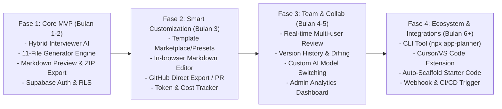
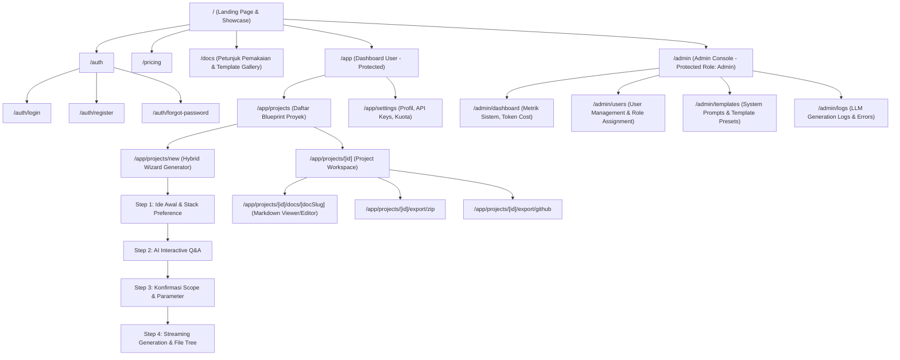

# Product Roadmap, Sitemap & Feature Tree: AppPlanner AI (PlanCraft)

Dokumen ini memetakan visi produk, roadmap rilis bertahap, sitemap navigasi aplikasi, serta dekomposisi fitur (*feature tree*) untuk **AppPlanner AI** — generator blueprint dokumentasi pre-development bagi developer dan *vibecoder*.

---

## 1. Product Roadmap

Roadmap dibagi menjadi 4 fase strategis (*V1 MVP, V1.5 Enhancement, V2 Collaboration, V2.5 Ecosystem*):

### Rincian Fase:
1. **Fase 1 — Core MVP (Tahap Saat Ini):**
   - Autentikasi user & admin berbasis Supabase (Email/Password + OAuth GitHub/Google).
   - Mode pembuatan hybrid: Prompt awal -> Dynamic AI Clarification Questions -> Konfirmasi -> Streaming Generation 11 Dokumen.
   - Output viewer: Sidebar file tree, visual Markdown reader (syntax highlighting, mermaid renderer), Copy-to-Clipboard, dan Download ZIP archive.
   - Manajemen proyek dasar: Create, Read, Update, Delete (CRUD) riwayat project planner.

2. **Fase 2 — Smart Customization & GitHub Sync:**
   - Template presets: Mobile App, SaaS Web, E-commerce, AI Agent, Microservice.
   - Fitur edit dokumen langsung di web dengan auto-save.
   - Push blueprint langsung ke repository GitHub user (membuat repo baru atau commit ke folder `docs/` atau `.gemini/`).
   - Limitasi kredit & billing (Stripe / Midtrans) untuk pengguna berbayar.

3. **Fase 3 — Collaboration & Admin Suite:**
   - Fitur workspace tim: undang rekan satu tim untuk mereview dan menambahkan catatan pada PRD.
   - Semantic diff viewer untuk melihat revisi dokumen antar generasi prompt.
   - Admin portal lengkap: audit log penggunaan token LLM, manajemen user, analytics konversi.

4. **Fase 4 — Dev Ecosystem & Developer Tooling:**
   - CLI Companion: `npx plan-craft init` untuk mendownload blueprint langsung ke root folder project lokal.
   - Integrasi langsung ke VS Code / Cursor rules generator (`.cursorrules`, `AGENTS.md`, `CLAUDE.md`).

---

## 2. Sitemap (Struktur Navigasi Aplikasi)

Sitemap dirancang intuitif, modular, dan membedakan akses antara publik, user terotentikasi, dan admin:

---

## 3. Feature Tree (Dekomposisi Fitur)

Hierarki fungsionalitas aplikasi diuraikan dalam struktur *feature tree*:

### 3.1. Authentication & Role-Based Access Control (RBAC)
- **Supabase Auth Integration:**
  - Registrasi & Login via Email + Password.
  - Social OAuth: GitHub (kritis untuk developer) dan Google.
  - Multi-tenant Session Management berbasis JWT token.
- **Role Hierarchy:**
  - `admin`: Akses penuh ke portal `/admin`, monitoring konsumsi token, konfigurasi model AI (Gemini, Claude, GPT), manajemen preset template global.
  - `user`: Akses ke `/app`, pembuatan dan penyimpanan blueprint proyek, manajemen API key pribadi (BYOK jika kuota habis), ekspor dokumen.

### 3.2. Hybrid AI Discovery & Interviewer Engine
- **Initial Brief Intake:**
  - Form input fleksibel (nama proyek, deskripsi 1-3 kalimat, opsi tech stack).
  - Quick-preset chips (SaaS, Mobile App, AI Wrapper, Internal Tool).
- **Conversational Clarification Engine:**
  - AI menganalisis brief dan menghasilkan 3–5 pertanyaan esensial (Arsitektur data, alur pembayaran, target integrasi pihak ketiga, skala).
  - User dapat menjawab secara fleksibel (teks bebas atau memilih opsi terpandu).
- **Context Synthesis:**
  - Penggabungan brief awal + jawaban klarifikasi menjadi *Master Architectural Brief* sebelum trigger generator file.

### 3.3. Multi-Document Generation Pipeline (11 Pre-Dev Files)
- **Streaming Orchestrator (Vercel AI SDK + LLM):**
  - Eksekusi pembuatan 11 file secara terstruktur dan sinkron:
    1. `map.md` (Roadmap, Sitemap, Feature Tree)
    2. `PRD.md` (Product Requirements Document, User Stories, Acceptance Criteria)
    3. `design_sistem.md` (Color tokens, Typography, Component Rules, Layout)
    4. `wireframes.md` (Responsive ASCII Wireframes, UI Screen Layouts, Role Views)
    5. `security.md` (Security Policy, Data Protection, Auth, RLS)
    6. `architecture.md` (High-Level Architecture, Component Diagram, Tech Stack)
    7. `database_schema.md` (PostgreSQL / Supabase Schema, DDL, ERD)
    8. `api_spec.md` (REST/RPC Endpoint contracts, JSON payload examples)
    9. `qa.md` (QA Strategy, Edge Cases, Test Matrix)
    10. `deployment.md` (CI/CD Pipeline, Environment Config, Hosting)
    11. `CONTRIBUTING.md` (Developer setup guide, Git workflow)
- **Consistency Engine:**
  - Tiap dokumen merujuk pada entitas, nama role, dan database schema yang konsisten agar tidak terjadi halusinasi beda nama variabel antar file.

### 3.4. Workspace Viewer, Editor & Export Hub
- **File Explorer Sidebar:**
  - Hierarki pohon file yang responsif dengan status status badge (*generating*, *ready*, *edited*).
- **Dual-Pane Markdown Viewer:**
  - Live markdown preview lengkap dengan Syntax Highlighter (Prism/Shiki).
  - Dynamic Mermaid.js rendering engine untuk ERD dan Flowchart.
  - Fitur "Copy Codeblock" dan "Copy Entire File".
- **Exporting Options (Opsi B):**
  - **ZIP Download:** Kompilasi seluruh 11 file markdown ke dalam arsip `.zip` dengan struktur folder rapi.
  - **Cursor / AI Bundle Export:** Ekspor dalam 1 file prompt tunggal terpadu (`ALL_SPECS_BUNDLE.md` atau `.cursorrules`) untuk langsung di-paste ke LLM context window.
  - **GitHub Push Integration (Phase 2 Ready):** Pembuatan otomatis commit langsung ke repositori GitHub baru atau cabang aktif.

### 3.5. Administration & Observability
- **Token Usage Tracker:**
  - Tracking token input/output per user dan per generasi dokumen.
  - Estimasi biaya LLM dan pencegahan *abuse* menggunakan rate limiting (*Upstash Redis / Supabase RPC*).
- **System Prompt Manager:**
  - UI untuk mengupdate prompt generator masing-masing file tanpa perlu redeploy kode aplikasi.
